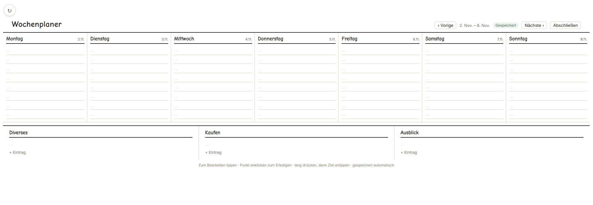

# Week Planner — Wochenplaner

A lightweight, paper-like weekly planning web app. Track appointments, a shopping list, miscellaneous tasks, and an outlook for the coming week. Data is persisted in MySQL through a small PHP backend.

> **Note:** The user interface is currently in German because the app was built for a German-speaking household. The code and this README are in English.



## Features

- 7 days with 8 appointment/task slots each
- Header shows the calendar week (KW) and the date range of the viewed week
- The current day's column is highlighted when you view the current week
- Three note sections: **Diverses**, **Kaufen**, and **Ausblick**
- Collapsible **Shit-Liste** (💩) backlog at the bottom of the page: a 6-column grid with at least 8 rows for things to do later; it grows downwards as needed
- Status dots to mark entries as done
- **Ausblick** previews next week's entries; items already marked as done are hidden
- Long-press an entry, then tap a target slot to move it within the same week or into another week — this works between the day grid, the note sections and the Shit-Liste
- The edit dialog has a 💩 button that moves any entry to the Shit-Liste
- Add a date to a **Diverses** or day-grid entry or a Shit-Liste entry and it automatically moves to that day's column
- Close a week: open **Kaufen** and **Diverses** items are carried over to the next week
- Optimistic locking with a conflict-resolution dialog when multiple devices edit the same week (or the Shit-Liste)
- Auto-save with a status pill and a local backup of unsaved changes
- The current week's data and the Shit-Liste are cached in localStorage so the planner stays usable without internet
- 90° rotation mode for tablets

## Tech stack

- PHP 8.x
- MySQL 8 / MariaDB (PDO MySQL extension)
- Vanilla JavaScript, HTML, CSS
- Docker Compose for local testing

## Quick start with Docker

1. Clone the repository.
2. Run:
   ```bash
   docker compose up --build
   ```
3. Open http://localhost:8080.

The database schema is imported automatically on the first start.

## Manual installation

1. Create a MySQL database and import the schema:
   ```bash
   mysql -u <user> -p <database> < schema.sql
   ```

2. Copy the configuration template and enter your database credentials:
   ```bash
   cp config.php.example config.php
   ```
   Or set the environment variables `DB_HOST`, `DB_NAME`, `DB_USER`, and `DB_PASS`.

3. Upload these files to the same directory on your web server:
   - `index.html`
   - `api.php`
   - `db.php`
   - `config.php` (if you created one)

4. Open the app through HTTP or HTTPS. It must be served from the same directory as `api.php`; opening `index.html` directly as a `file://` URL will not work because the browser's `fetch()` calls need an HTTP origin.


## Usage

- Tap an entry to open the edit dialog.
- Tap the 💩 button in the dialog to move the entry to the Shit-Liste.
- Tap **💩 Shit-Liste** at the bottom to open or close the backlog; tap any cell to edit it.
- Long-press an entry for about 350 ms, then tap the target slot to move it — targets are day-grid slots, note sections and Shit-Liste cells.
- Set a date on a **Diverses** or day-grid entry, or on a Shit-Liste entry, to have it jump to that day's column automatically.
- Use **Woche abschließen** to mark the current week closed and carry open shopping/misc items into the next week.

## Security note

There is **no built-in authentication**. Anything that can reach `api.php` can read and write all week data. Before exposing the app to the public internet, place it behind a reverse proxy, VPN, HTTP Basic Auth (e.g. `.htaccess`), or another access-control layer. Note: `force: true` (week saves only — the Shit-Liste rejects it) bypasses the revision check and replaces a whole list in one request. Write requests must send `Content-Type: application/json`; other content types are rejected to block cross-site form posts. Do not add `Access-Control-Allow-Origin` to `api.php` — it would break this protection.

## API overview

- `GET api.php?week=YYYY-MM-DD` — load a week.
- `GET api.php?week=YYYY-MM-DD&revision_only=1` — lightweight revision poll.
- `POST api.php` with `{ week, days, notes, closed, base_revision }` — save a week (base_revision must be an integer; item text must be a string of at most 8000 bytes).
- `GET api.php?shitlist=1` — load the Shit-Liste (`{ items, revision }`).
- `GET api.php?shitlist=1&revision_only=1` — lightweight Shit-Liste revision poll.
- `POST api.php` with `{ type: "shitlist", items, base_revision }` — save the Shit-Liste (base_revision must be an integer; max 400 items; item text max 8000 bytes).
- Stale writes return HTTP 409 with the current server state so the client can show a conflict dialog.

### Known limitation

The week plan and the Shit-Liste are saved as two independent requests (each with its own revision), so a cross-store move is not atomic. If the backlog hits a conflict during such a move the dialog offers safe choices: „zusammenführen“ keeps the server entries and appends the locally moved item; „Abbrechen“ loads the server version and discards entries that are locally new. While the dialog is resolving, backlog cells are briefly locked against edits, deletes and move targets. Because backlog entries have no stable IDs yet, a merge cannot detect deleted or edited-elsewhere entries: local deletions can reappear and entries that changed since the last sync (edits, done-toggles) can end up duplicated — follow-up: ID-based entries with a real three-way merge. A merge result is capped at 400 entries (server entries first); anything over the cap is dropped locally with a warning so the list stays savable. Resolving the week-side conflict with "Server-Version laden" re-inserts the most recent backlog→week move; an entry moved in an earlier, separate save can still be lost — real data loss until a single transactional endpoint exists. Unsaved edits normally survive closing the tab — the flush requests are sent with `keepalive`; only very large payloads (over ~64 KB, i.e. hundreds of backlog entries) can still be lost mid-save. A single transactional endpoint would remove the remaining edge cases entirely. Swaps that would push an entry into an occupied cell of the other store are blocked — free the target cell first. A backlog entry whose move into a different week succeeded can reappear in the backlog when the backlog save then hits a conflict and is resolved with „Abbrechen“ — dedupe by hand. The mirror case: if the backlog save succeeded and the week save then hits a conflict resolved with „Server-Version laden“, the entry exists in both stores — dedupe by hand as well.

## Credits

This project was built with the coding assistance of:

- **Claude** by Anthropic
- **Kimi k2.7** by Moonshot AI
- **Cline** 

## License

MIT License — see [LICENSE](LICENSE).

